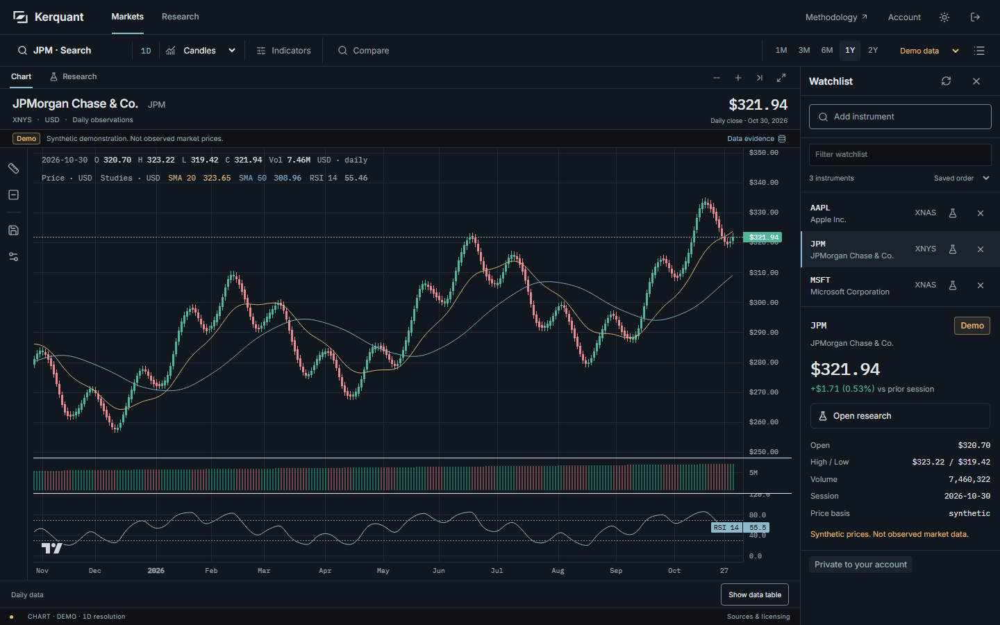
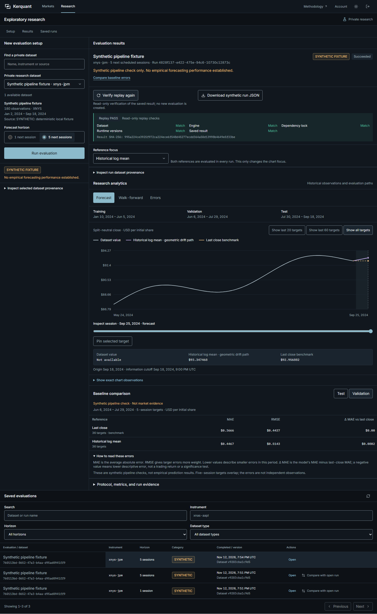

# Kerquant

Kerquant is a financial analytics and quantitative research terminal built with Next.js, TypeScript, Django, and Python. It combines a chart-first market workspace with private watchlists, inspectable datasets, chronological baseline evaluations, saved comparisons, and deterministic replay.

**The portfolio demo uses synthetic prices and synthetic research. No validated forecasting performance, investment recommendation, or live trading is offered. Production remains NO-GO.**



## Explore the application

- Analyze daily candlesticks, OHLCV, volume, SMA, RSI, EMA, and Bollinger studies. Adjust chart types/scales, compare common-session indexed series, measure movements, and save local display layouts.
- Search 20 curated US instruments, manage an account-private watchlist, and open research for an instrument with an available private dataset.
- Inspect dataset provenance, choose a one- or five-session horizon, compare persistence and expanding historical-log-mean baselines, review chronological periods, export exact results, and replay saved identities.
- Use responsive desktop/mobile layouts, light and dark themes, keyboard controls, password changes, and session revocation.



The [portfolio guide](docs/PORTFOLIO.md) gives a presentation walkthrough. The [research methods](docs/RESEARCH.md), [architecture](docs/ARCHITECTURE.md), and [publication record](docs/PUBLICATION.md) describe the supported scope and its limitations.

## Start the local workspace

Use Python 3.12, Node 22 LTS version 22.12 or later, npm, and Git. The first setup downloads pinned Python dependencies and installs the frontend from `web/package-lock.json`. It creates a separate `.venv`; it does not replace a retained legacy environment or database.

Clone this repository, change into its root, and run the commands for your platform. On Windows, use PowerShell:

```powershell
git clone https://github.com/virajchoudhary/stock-predictor-system.git
cd stock-predictor-system
./scripts/setup.ps1
.venv/Scripts/python.exe scripts/demo.py
```

On Linux or macOS:

```sh
git clone https://github.com/virajchoudhary/stock-predictor-system.git
cd stock-predictor-system
sh scripts/setup.sh
.venv/bin/python scripts/demo.py
```

Open [Markets](http://127.0.0.1:3000/app/markets), [Research](http://127.0.0.1:3000/app/research), or [Account](http://127.0.0.1:3000/app/account). Read the generated initial credentials from `.local/portfolio-demo/credentials.json`. Never publish that file. API health is available at [127.0.0.1:8000/health](http://127.0.0.1:8000/health/).

The launcher explicitly creates a synthetic account, a starter watchlist, and saved baseline evaluations. Demo data lives in `.local/portfolio-demo/workspace.sqlite3`. Restarts preserve the account, current password, run identities, and watchlist edits. After changing your password, use the changed password; the initial credentials file is not updated.

Stop the launcher with Ctrl+C. On later starts, run only `scripts/demo.py`. If ports are occupied, select free alternatives:

```powershell
.venv/Scripts/python.exe scripts/demo.py --web-port 3001 --api-port 8002
```

For an optimized local frontend, add `--build`. Stop any existing preview before building against its `.next` directory. The API remains a loopback development server; this command does not deploy or qualify production.

## Architecture and data integrity

| Layer | Implementation |
| --- | --- |
| Terminal | Next.js App Router, React, TypeScript, Tailwind, Radix components, and TradingView Lightweight Charts |
| API and accounts | Django, Django REST Framework, same-origin session/CSRF controls, and account-private datasets/watchlists/results |
| Persistence | PostgreSQL application support; isolated SQLite for the single-command local demo |
| Research | Immutable dataset/run identities, causal chronological baselines, provenance receipts, and deterministic replay |
| Operations | Preserved container, migration, backup/restore, and release-check tooling with separate qualification records |

TradingView Lightweight Charts is a third-party charting library. Its required attribution remains visible. Kerquant is not affiliated with TradingView.

The demo launcher disables external market providers and legacy scheduling. Provider failures never silently substitute demo data. The optional yfinance adapter requires separately permitted development-only personal use; enabling a setting does not establish storage, display, or redistribution rights.

Historical dataset admission requires source rights, complete price/action semantics, calendar continuity, and point-in-time availability evidence. No historical archive has passed those gates. Fixture MAE/RMSE values demonstrate pipeline behavior, not forecasting accuracy. See [research methodology and source qualification](docs/RESEARCH.md).

## Run checks

```powershell
.venv/Scripts/python.exe scripts/check_backend.py
.venv/Scripts/python.exe -m unittest discover -s tests -p test_research_client.py
cd web
npm run build
npm run typecheck
npm run lint
npm test
```

Use the [disposable browser acceptance procedure](docs/PORTFOLIO.md#run-browser-acceptance) for Chromium tests. It creates separate test accounts and consumes one-use lifecycle tokens. Do not target a retained personal workspace.

The [publication record](docs/PUBLICATION.md) separates local verification from hosted CI. PostgreSQL-only tests require a PostgreSQL test environment and skip under SQLite.

## Preserved research and limitations

ARIMA/GARCH, BiLSTM/HPO, portfolio optimization, derivatives, RL, Streamlit, and reporting implementations remain preserved research code. Their existence does not qualify them as forecasting models or investment tools. The legacy launcher requires its own dependency environment and configuration; it is outside the supported fresh-clone portfolio demonstration.

Production remains **NO-GO** until image-security, hosted CI, operational acceptance, and applicable data-rights gates pass. No live trading, financial advice, certification, or production-readiness claim is made.

The display name remains configurable through `NEXT_PUBLIC_PRODUCT_NAME` and `NEXT_PUBLIC_PRODUCT_SHORT_NAME`. Existing package, environment, database, and repository identifiers retain their historical names. Kerquant's trademark/domain clearance remains unverified. No repository rename, domain purchase, or deployment is implied.

**Historical data notice:** databases, runtime files, and model/progress archives have been excluded from the current portfolio tree. Their earlier versions remain accessible in existing public Git history. That history has not been sanitized or rewritten. See [the publication boundary](docs/PUBLICATION.md).
