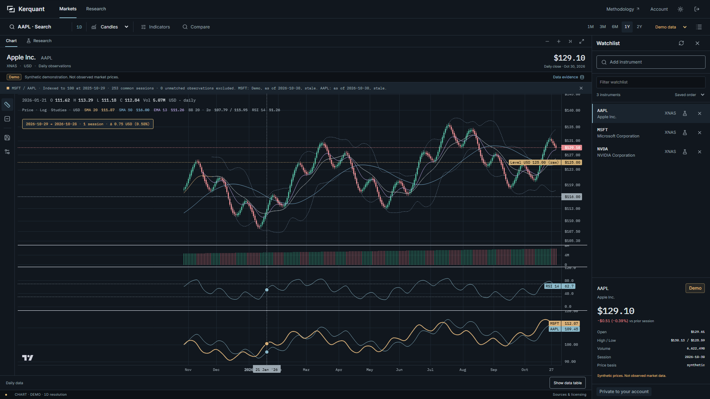
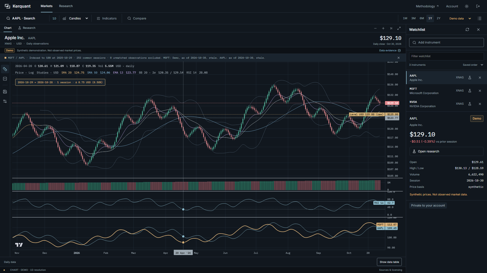
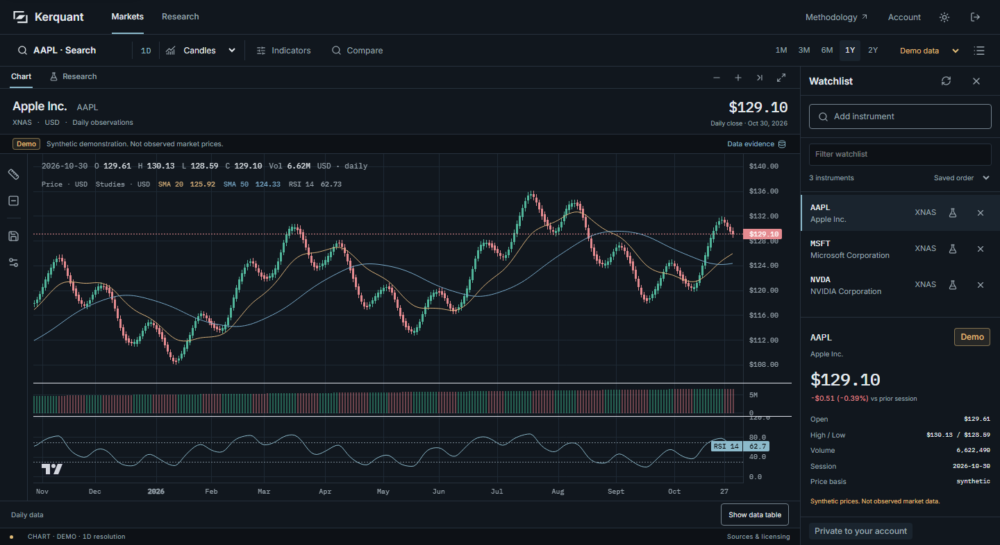
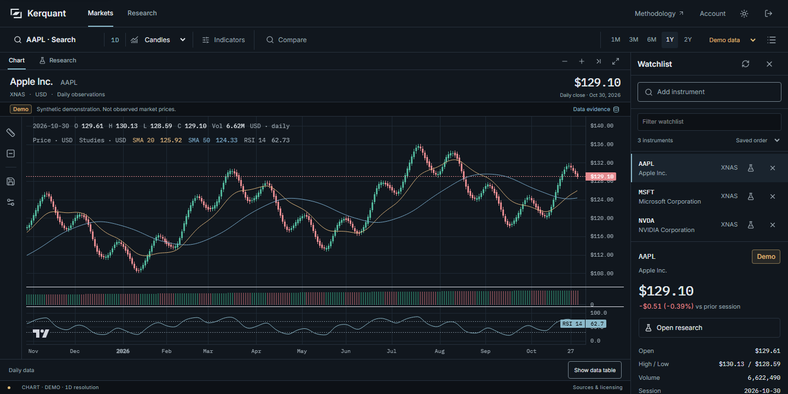
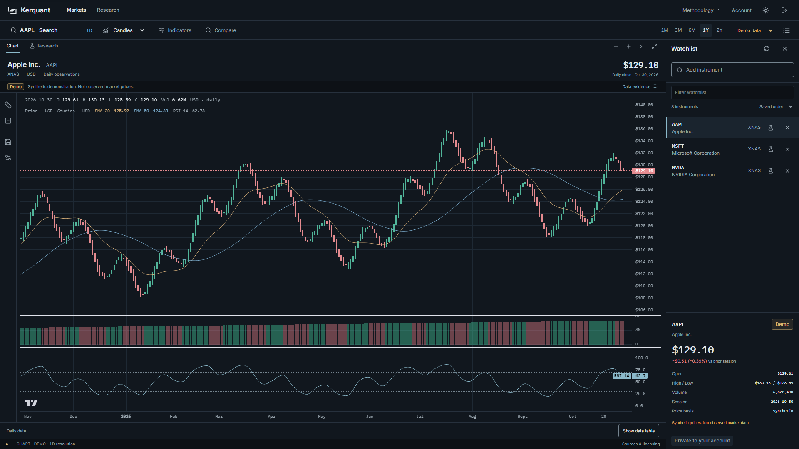
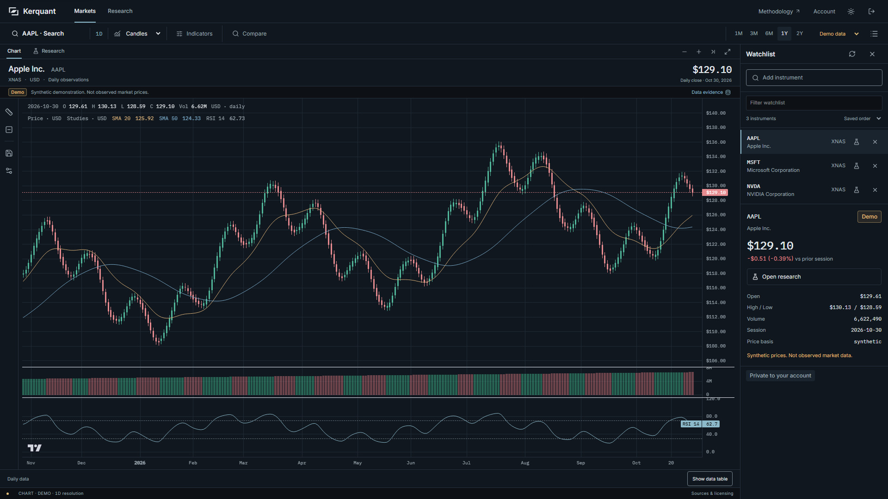
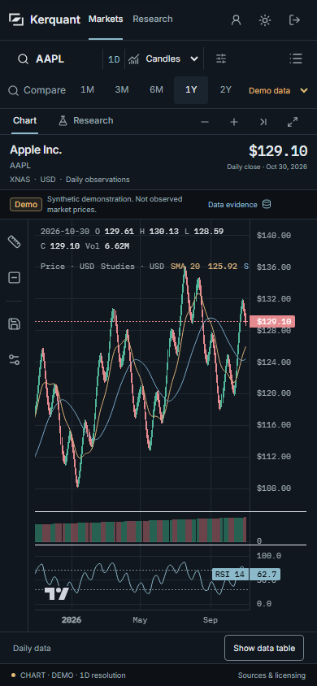
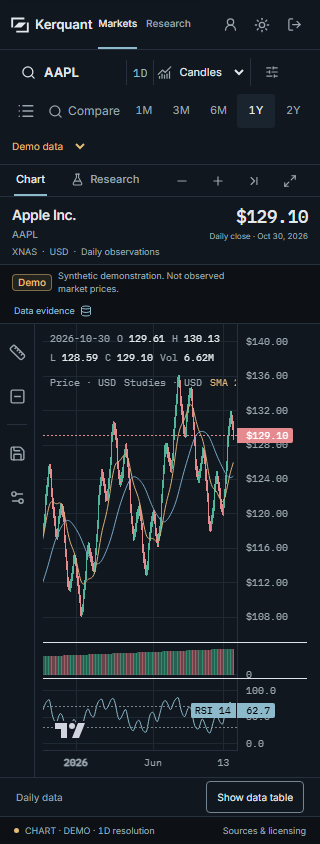
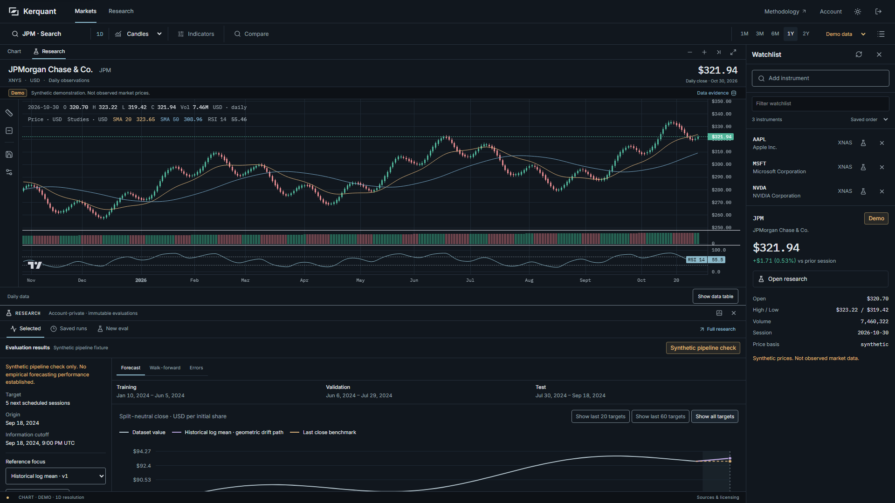
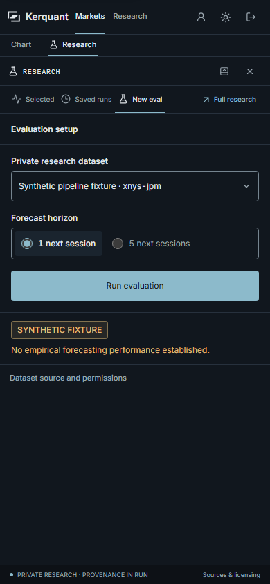

# Rendered viewport evidence

All images are real Chromium captures. Demo prices and synthetic research are retained. Independent browser contexts can have different chart ranges or settings; these comparisons establish layout and interaction behavior, not changes to financial performance.

## Use the full plot width when resizing

The previous terminal screenshot shows empty leading time space after expanding the chart. The final screenshot keeps the viewed period across resizing. Both show the existing daily Demo chart, technical studies, indexed comparison and measurement tools.

| Before this pass | After this pass |
| --- | --- |
|  |  |

The before image is retained from the prior audit's actual terminal-depth run. The separate resize-mechanics receipt reproduces the underlying default-versus-locked behavior with the installed library and explicit synthetic renderer inputs.

## Fit the laptop viewport

At a requested 1440 x 720 viewport, the earlier page required 786px. The final workspace fits within 720px, including the data-table control and terminal footer.

| Before | After |
| --- | --- |
|  |  |

## Bring selected quote details beside the analysis

The three-item list no longer expands into hundreds of empty pixels above the quote. The selected snapshot follows the rows and offers research access even when the selected instrument is not saved.

| Before | After |
| --- | --- |
|  |  |

## Fill the phone's available height

The 390px layout fits the viewport. The 320px layout reserves its actual wrapped toolbar height and keeps chart, provenance, table control and footer accessible without document overflow.

| 390 x 844 | 320 x 844 |
| --- | --- |
|  |  |

Long study readouts retain native horizontal scrolling and keyboard focus. The visible chart type, daily-only interval and Demo status remain explicit. Nothing in these screenshots represents a live quote.

## Research remains part of the terminal

The price pane uses more of the available chart area. The original 400px research default is retained after a smaller trial left too little analytics visible. Resize, maximize, exact saved identities and replay/export remain. The mobile workflow opens research for the selected unsaved instrument and dismisses the watchlist drawer.

These screenshots supplement the source-bound functional and accessibility checks. They do not establish physical-device behavior, full WCAG conformance, or commercial-terminal feature parity.
