# Browser evidence

Before images are original in-app Chromium captures. Their actual image dimensions are retained below; browser chrome, scrollbars and available capture area differ. After images come from the compiled application in Playwright Chromium. These are observations of the application, not design mockups or generated images.

## Chart workspace

The chart, compact toolbar, watchlist, study readouts, provenance strip and integrated research entry remain the primary terminal. The mobile settings correction removes an empty stretched panel while retaining bounded access to every setting.

Before desktop, 1440 x 810 capture:

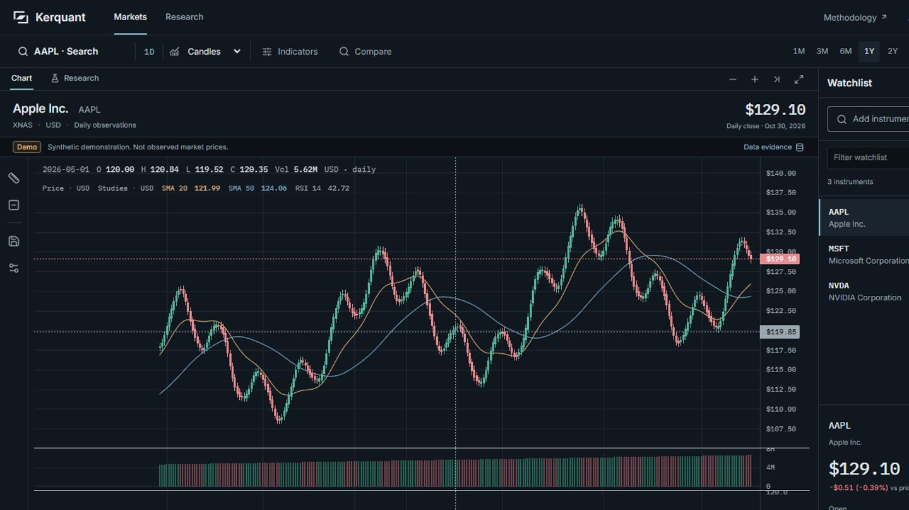

After desktop, requested viewport 1440 x 900:

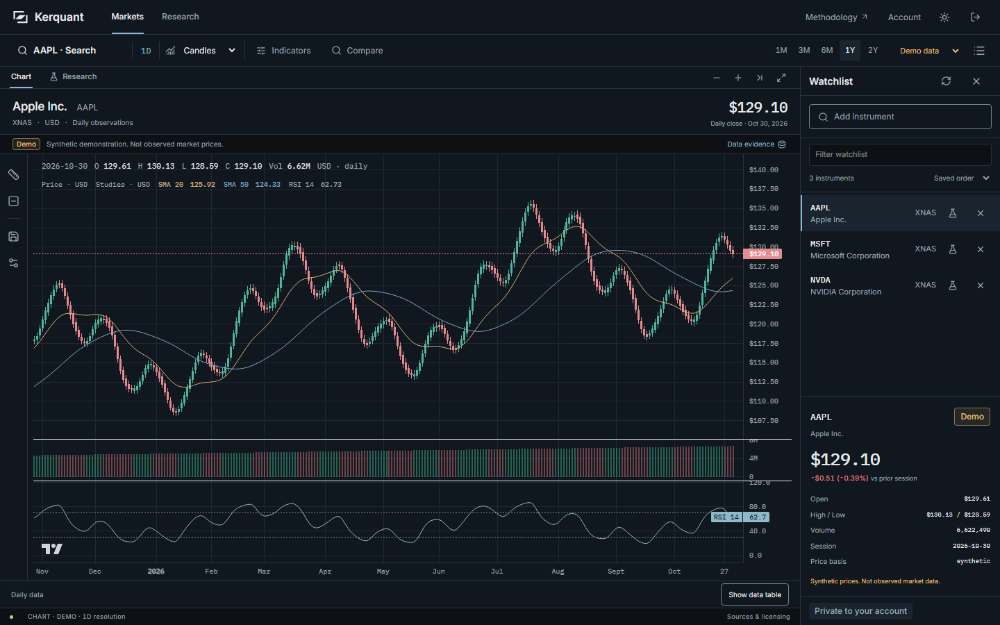

After desktop, requested viewport 1920 x 1080:

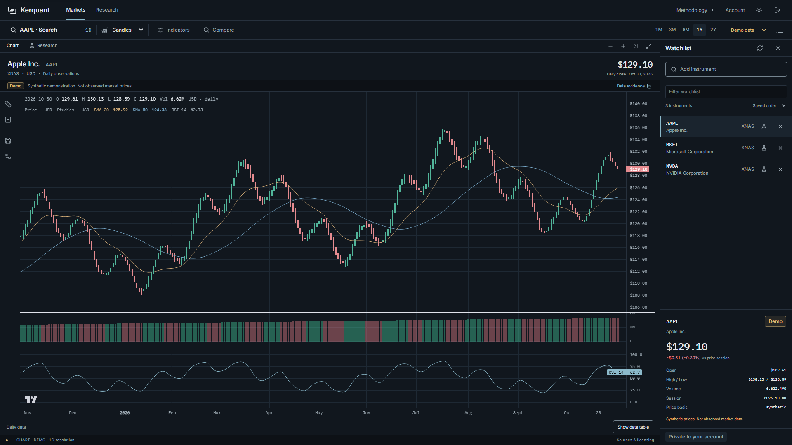

Preserved chart depth exercised by the real browser suite, including log scale, studies, a level, session measurement and indexed Demo comparison:

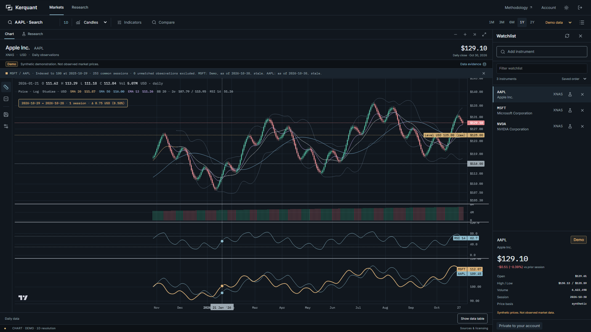

Integrated research remains native to the market workspace, with exact saved-run provenance and separate synthetic results:

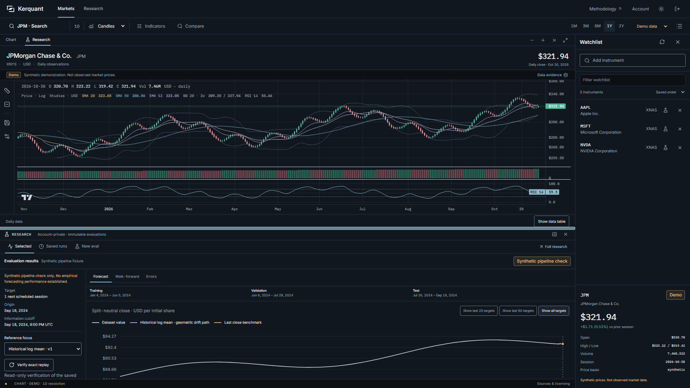

After tablet, requested viewport 820 x 1180:

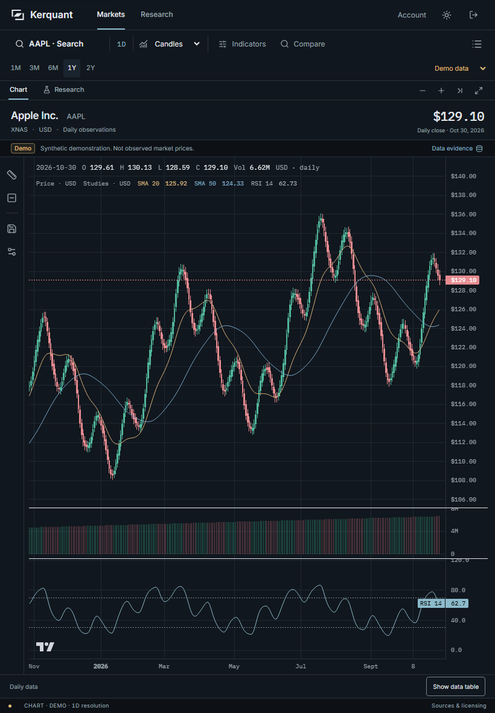

After phone settings, requested viewport 390 x 844:

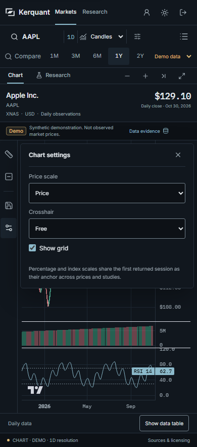

The baseline settings geometry is recorded in `product-browser-before.txt`. There is no separately retained before-settings image in this package; the ordinary before-market image is not evidence of that panel's open state.

## Research navigation

Before Open changed the selected result but left the viewport in the registry, 375 x 812 capture:

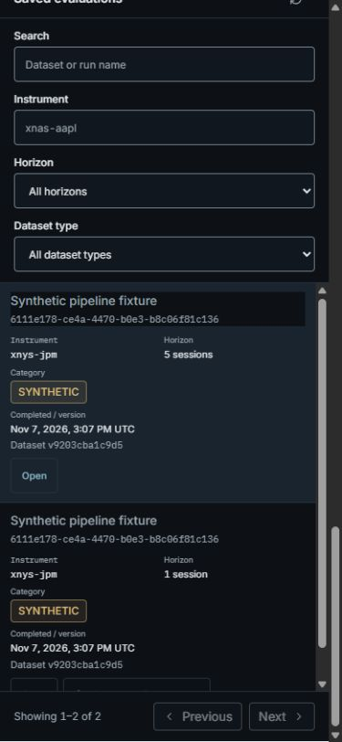

After the selected result is brought into view by the exact result fragment. The browser scenario subsequently activates Saved runs and captures its destination:

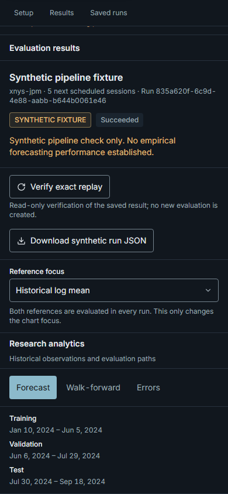

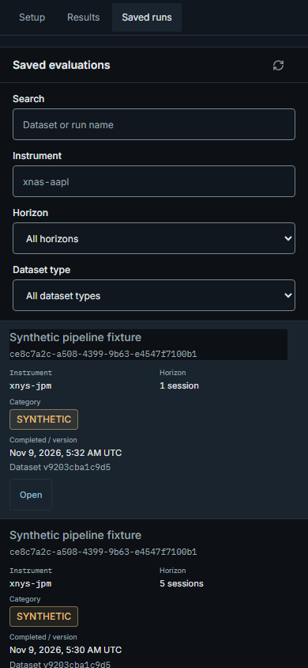

The viewport assertion for the selected Evaluation results heading runs before navigating back to Saved runs. This screenshot alone does not prove the selected-heading assertion; the browser log and test provide that evidence.

Standalone research after, requested viewport 1440 x 900:

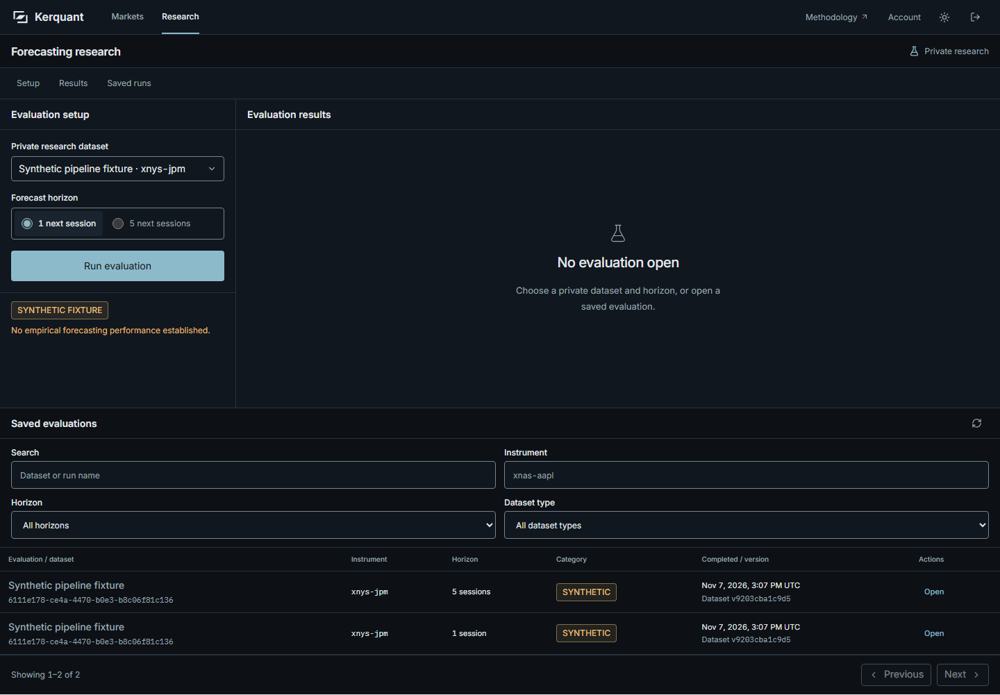

## Shared account navigation

Before, 390 x 844:

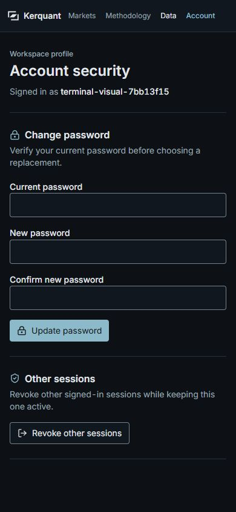

After, 390 x 844 with theme changed through the actual header control:

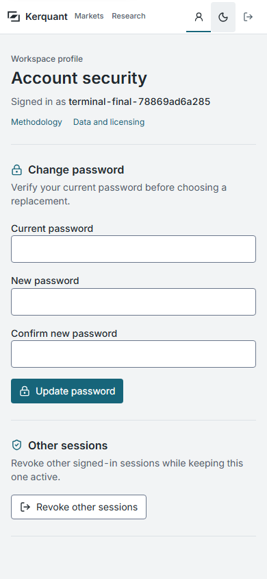

The complete local capture set includes Markets, Research, Account, Data and Methodology at 1440 x 900, 1920 x 1080, 820 x 1180 and 390 x 844, plus desktop/mobile sign-in. Full-page image height can exceed the requested viewport. The retained manifest records requested dimensions, route titles, overflow checks and source identity.

## Review disposition

The parent reviewed the complete 22-image contact sheet and focused market, research, settings, account, saved-result, customized-chart and dock captures. No additional blocking overflow, obscured required control or misleading provenance was observed. The screenshots support this bounded disposition; they do not establish every possible interaction state.

The separate visual review's one low-severity mobile legend finding was triaged against a real native-keyboard check. The final study values remain reachable through the existing scrollable, focusable legend, as shown below. No code change was needed for that finding. See the verification record for the original FAIL verdict and its limits.

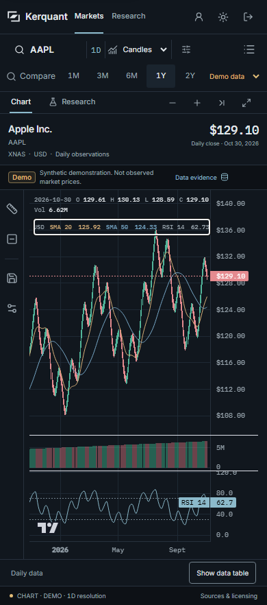

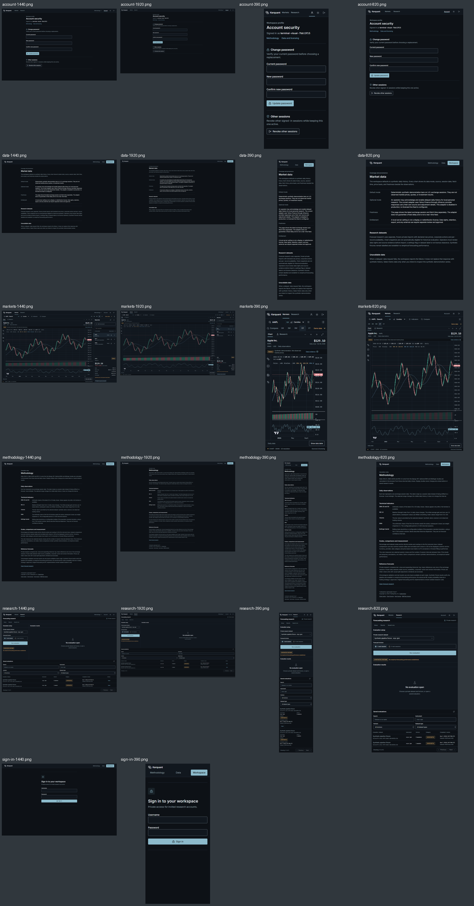

Firefox, WebKit and physical-device touch behavior remain unverified. An axe or browser-test pass is not a claim of full WCAG conformance or professional-terminal feature parity.
