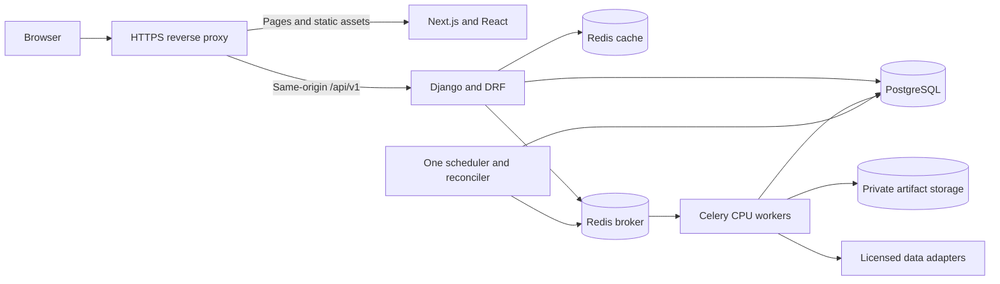

# Target architecture and migration decisions

Status: proposed for approval. These decisions do not change the running application. The package recommends an incremental replacement of user surfaces and service boundaries while retaining reviewed quantitative code.

## System shape

Use a modular Django application with a Next.js frontend and independently deployed Python workers. Keep PostgreSQL as the system of record. Use Redis for a bounded Celery broker and a separate cache instance. Store immutable datasets and model artifacts in object storage when deployed. Start with ordinary containers and one region. Kafka, Kubernetes, MongoDB, a feature-store platform, and a separate microservice per model are not justified by the first release.

This is a proposed deployment diagram, not an inventory of running services. The browser never receives provider keys or direct broker/storage credentials. Workers and Django share domain code, not in-process mutable singleton state.

## Decision register

| ID | Decision | Reason and alternative |
| --- | --- | --- |
| A01 | Next.js App Router, React, strict TypeScript, Node 24 LTS, locked package graph | Meets the requested stack and supports public pages plus a client chart workspace. A plain React SPA is simpler for the terminal alone but weaker for the combined public product site. Keep server components for shell/public content and client components for chart interaction |
| A02 | Django 5.2 LTS on Python 3.12 as the proposed clean-environment target, latest supported security patch at implementation | Long support window and broad numerical-wheel compatibility. The current environment has unsupported Django 5.0.14 and Python 3.13.9, with an unpinned Django requirement. Do not modify that environment in place. Verify all migrations/dependencies on a clean target before accepting this line. Django 6.x is viable if dependency checks favor it; record a revised decision before coding against new APIs |
| A03 | DRF HTTP API, same-origin browser session | Retains Django and avoids a second identity store. Browser uses secure session cookies and CSRF. API authorization is enforced on every object. OIDC is a later adapter for team/enterprise access, not a new auth database |
| A04 | PostgreSQL 17, current supported minor, psycopg 3 | Stable relational records and transactional ownership. PostgreSQL 18 is a reasonable alternative after driver/hosting validation. SQLite remains disposable local research only. Time-series extensions wait for measured query/storage pressure |
| A05 | Celery 5.6-compatible dependency set, Linux CPU workers, Redis broker | Existing Celery tasks can be adapted. RQ would reduce API surface but introduces queue migration for little gain. RabbitMQ is a future broker option when stronger broker operations justify another service. No native Windows production worker |
| A06 | Redis cache and broker have separate processes, policies, and credentials | Cache eviction must not remove queued work. Redis logical DB numbers alone do not isolate memory eviction. Redis release/license selection is reviewed before deployment; no unpinned `redis` container |
| A07 | Lightweight Charts for financial history, Plotly retained for selected analytical plots/reports | A focused canvas price engine fits the workspace. Retaining Plotly avoids rewriting worthwhile report visualizations. Advanced Charts is a separate licensed offering and is not assumed available. ECharts is a fallback if attribution or chart requirements change |
| A08 | Python domain modules extracted behind stable interfaces, no formula rewrites in TypeScript | One calculation owner prevents frontend/backend drift. BSM, BL, optimizer, metrics, and forecast workflows each acquire fixtures and typed input/output contracts before moving |
| A09 | Versioned REST and generated TypeScript contracts from an OpenAPI schema | Keeps schema changes reviewable and lets CI detect drift. Avoid a parallel handwritten TS model per endpoint. GraphQL does not solve the current long-running work, authorization, or provenance problems |
| A10 | Immutable run and data snapshot records | A saved result must remain explainable after provider corrections or model changes. Store provenance and hashes, not just the most recent float |
| A11 | One active Django/Celery job path | The FastAPI Redis-list scaffold remains preserved but excluded from deployment. Consolidate only after caller inventory. It is not a second production scheduler |
| A12 | No LLM or embedding dependency in the R1 critical path | Forecast numbers and portfolio weights come from reviewed quantitative code. Research assistance later uses sourced, bounded context and cannot execute trades or change numerical outputs |

## Official-documentation validation

The [Next.js installation guide](https://nextjs.org/docs/app/getting-started/installation) supports App Router, TypeScript, and the proposed runtime floor. Node 24 is selected from the [Node release table](https://nodejs.org/en/about/previous-releases), rather than adopting the minimum supported Node version as a production choice. Run lint explicitly in CI; a successful Next build is not a lint result.

The [Next.js self-hosting guide](https://nextjs.org/docs/app/guides/self-hosting) supports a reverse proxy and discusses shared caches for multiple instances. The [data-security guide](https://nextjs.org/docs/app/guides/data-security) supports retaining an existing HTTP API boundary. User-specific responses are uncached by default, and Django remains the authority for permissions.

The [Django support table](https://www.djangoproject.com/download/) lists 5.2 LTS support through April 2028. The [5.2 installation FAQ](https://docs.djangoproject.com/en/5.2/faq/install/) includes Python 3.12. [DRF's requirements](https://www.django-rest-framework.org/) include Django 5.2. These establish a plausible target, not a verified lockfile for this repository. Old pins such as `django-celery-beat==2.6.0` must be resolved against the selected Django/Celery combination before the target is accepted.

The [PostgreSQL policy](https://www.postgresql.org/support/versioning/) lists version 17 as supported through November 2029. The [Celery Redis guide](https://docs.celeryq.dev/en/stable/getting-started/backends-and-brokers/redis.html) documents redelivery and visibility timeouts. The [task guide](https://docs.celeryq.dev/en/stable/userguide/tasks.html) makes idempotent execution necessary when retrying work. Do not claim exactly-once delivery. Celery's [Windows support history](https://docs.celeryq.dev/en/latest/history/whatsnew-4.0.html) supports using Linux containers or WSL2 rather than relying on the existing Windows solo-worker launcher as a production guarantee.

The [Lightweight Charts project](https://github.com/tradingview/lightweight-charts/blob/master/README.md?plain=1) describes Apache-2.0 licensing and an attribution/link requirement. Preserve LICENSE and NOTICE, provide third-party notices, and keep the supported chart attribution link visible. Review the actual locked release. No data feed, exchange entitlement, Pine execution, or full drawing terminal is included by choosing the library.

## Frontend ownership

Create `web/` after approval. Leave `frontend/` as the legacy Streamlit app until its accepted routes are replaced. Use `web/src/app` for routing, `features/markets`, `features/research`, and later feature folders for user workflows, and `components/ui` for small shared controls. `lib/api` owns transport and generated contracts. `lib/chart` adapts chart lifecycle and semantic tokens. Do not build a generic plugin framework for six planned modules.

URL state owns instrument, visible range, and selected tab when useful for links. Component state owns hover and open menus. Server data owns watchlists, notes, jobs, and permissions. Avoid duplicating all three in one global store. Poll only active jobs with a bounded backoff; R1 does not need a WebSocket service or server-sent market feed.

The browser calls `/api/v1` through the same origin. Next public pages do not read the database directly. If authenticated server rendering is later needed, forward only the necessary session and CSRF context to Django and mark responses private. Never place user data in a shared Next or CDN cache, or rely solely on Next middleware for authorization.

Managed frontend hosting is a valid later alternative, especially for public pages. It still needs a Python API, worker host, and careful origin/session routing. The proposed single-region container deployment keeps session boundaries and operating costs easier to inspect for the preview. A specific cloud vendor is deferred until region, data terms, and the approved budget are known; no vendor account is needed for local implementation.

## Django modules and reusable Python

Create domain boundaries by moving one accepted workflow at a time. Proposed modules are `market_data`, `research`, `runs`, `forecasting`, `portfolios`, and `derivatives`. Keep request parsing in serializers/views, orchestration in application services/tasks, and formulas in pure Python functions. A formula function accepts explicit data and conventions, not request objects or provider clients.

Extract rather than duplicate the tested parts of `backend/api/black_scholes.py`, `bl_numpy.py`, `bl_optimizer.py`, `PortfolioOptimizer`, and `quant_reporter`. Separate data retrieval from metrics and report rendering. Delay FastEmbed initialization until a research feature explicitly needs it. Remove provider/model construction from import paths before using the API in CI or production.

Keep internal package names independent of the chosen public brand. The historical Django project directory can retain its name temporarily. A later internal rename requires import, Celery, WSGI/ASGI, migration, and launch-path tests. Do not change historical migration app labels to perform a cosmetic rebrand.

## Persistence model

| Record | Required fields and invariants |
| --- | --- |
| User / membership | Django user identity, account state, role, and ownership scope. Start with personal workspaces; no cross-user sharing in R1 |
| Instrument | Stable ID, provider aliases, symbol, venue, MIC where known, currency, asset class, exchange timezone, session calendar, active dates |
| Data snapshot | Provider/dataset identity, fetched time, bar cutoff, adjustment policy, entitlement profile, content hash, object reference, schema version |
| Bar | Instrument, session/UTC instant, interval, OHLCV, source, adjustment basis, quality flags; unique on full series identity and time |
| Watchlist / item | User owner, name, instrument, position, revision. Unique instrument per list |
| Research note | User owner, title, content, instrument links, run links, revision, timestamps |
| Run | Server-generated ID, owner, kind, canonical inputs, input hash, snapshot ID, status, attempt, stage, heartbeat, error code, output manifest |
| Model artifact | Model family, architecture/config, feature schema, scaler, training cutoff, tuning cutoff, code SHA, dependency lock hash, seed/runtime, artifact digest, approval status |
| Evaluation | Artifact/snapshot IDs, locked split IDs, horizon, metrics, baseline, sample count, costs/conventions, reviewer decision |
| Portfolio scenario | Owner, base currency, weights/constraints, rebalance and cost assumptions, version; not a brokerage account |

Use decimal strings and PostgreSQL NUMERIC for stored money, quantities, and weights requiring decimal integrity. Numerical solvers may use float64 internally with explicit tolerances. Keep unrounded numeric outputs and format at the boundary. Never sum mixed currencies without dated FX conversion. JSON contains no NaN or infinity.

Daily session identifiers are dates in the exchange calendar. Provider timestamps remain available separately. Snapshot corrections create a new version. Data retention and export permissions attach to the provider entitlement, not just the user who happened to fetch the data.

## API contracts

| Endpoint proposal | Behavior |
| --- | --- |
| `GET /api/v1/instruments?query=...` | Validated bounded search; returns venue/currency-qualified results |
| `GET /api/v1/instruments/{id}/bars` | Explicit interval, range, adjustment basis, cursor; returns provenance envelope and ordered bars |
| `GET /api/v1/instruments/{id}/baseline` | Returns a saved baseline run or an explicit unavailable reason; never trains on GET |
| `GET/POST /api/v1/watchlists` and item endpoints | User-scoped persistent watchlist; CSRF required on mutations |
| `GET/POST/PATCH /api/v1/research-notes` | User-scoped notes, revision precondition on updates, sanitized content |
| `POST /api/v1/runs` | Validated run kind/configuration, quota check, persistent run, HTTP 202 and Location header |
| `GET /api/v1/runs/{id}` | Owner-authorized durable status and output references |
| `POST /api/v1/runs/{id}/cancel` | Idempotent cancellation request; completed result is not silently deleted |
| `POST /api/v1/derivatives/european-price` | Later bounded deterministic calculation with explicit units and conventions |

The market envelope includes `instrument_id`, `currency`, `interval`, `price_basis`, `source_id`, `snapshot_id`, `as_of`, `fetched_at`, `market_state`, `data_mode`, `freshness_state`, and any `delay_seconds`. `data_mode` distinguishes market data, synthetic demo, and user assumptions. `freshness_state` distinguishes current for the promised cadence, stale, partial, and unavailable. A null delay does not mean real-time.

Error envelopes include `code`, `message`, `field_errors`, `request_id`, and retry guidance where applicable. Use 400 for malformed requests, 403 for forbidden operations, 404 for inaccessible private objects, 409 for version/idempotency conflicts, 429 for quota limits, and 503 for temporary dependency failures. Define authentication-expiry behavior consistently with the chosen DRF session policy. Do not convert failures into HTTP 200 with an apparent numeric success.

## Job execution and caching

Persist Run before dispatch. Dispatch after database commit. Reconcile pending records whose broker dispatch failed so a successful HTTP response cannot hide a permanently lost job. A job's idempotency key binds user, operation, canonical inputs, snapshot, and artifact version. A reused client key with different inputs returns a conflict. Database state and attempt claims prevent duplicate visible results under redelivery.

States are `queued`, `running`, `cancel_requested`, `succeeded`, `failed`, `cancelled`, and `expired`. Enforce allowed transitions. Stage updates use heartbeats, not guessed progress. Retry only transient provider/broker failures with bounded backoff and jitter. Invalid data, infeasible constraints, and model failures require an explicit outcome. Set soft/hard limits and memory quotas by job type. A web-request timeout is not cancellation of CPU work.

Separate short ingestion/inference work from expensive research/training queues. R1 permits bounded CPU baseline jobs only. Research training is operator-triggered in P1, never public request-triggered. One scheduler owns periodic ingestion. Beat file state and global JSON progress files are not the durable job store.

Cache public market data only within its licensed audience and retention rules. Include provider, series identity, adjustment, time range, data version, and entitlement profile in the key. Cache user-derived results by owner or share scope. TTL is an optimization; timestamps and session calendars decide staleness. Prevent duplicate provider fetches for the same snapshot. Broker persistence and no-eviction settings are separate from an expendable market cache.

## Migration sequence and reversibility

1. Preserve the current tree and record behavioral fixtures. Capture the database only through an approved backup procedure; do not overwrite the existing dirty file.
2. Establish clean Linux dependency locks and import-safe quantitative entry points. Characterize existing behavior before fixing financial conventions.
3. Add PostgreSQL-backed instrument, snapshot, run, watchlist, and note records in additive migrations. Existing HPO cache remains a research input, not an approved artifact registry.
4. Add versioned endpoints behind the same-origin proxy. Test authentication and ownership independently of the UI.
5. Build the approved Next workspace in `web/` against fixtures, then the versioned API. Compare each accepted workflow with the retained Streamlit path.
6. Deploy only after separate approval. Roll back frontend/API routing and container image versions without reversing a destructive schema migration. Additive database schema supports the previous image during the rollback window.
7. Retire old public routes only after caller inventory, acceptance, and a stated deprecation window. Preserve useful research modules and fixtures. Repository cleanup, artifact removal, and internal rebranding are separately scoped work.

Before a production migration, rehearse SQLite-to-PostgreSQL copying on a backup with counts, unique symbols, timestamps, constraints, and representative records compared. Determine whether historical HPO records are worth importing. Never carry an old validation score forward as a newly verified result.
