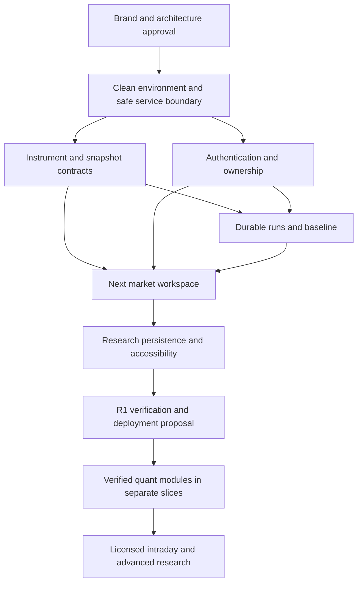

# Implementation roadmap and acceptance gates

The owner authorized stabilization and the initial frontend milestone on 2026-11-05. This roadmap still defines the broader release gates. See [implementation status](../implementation/STATUS.md) for actual scope and evidence. Deployment and spending remain separate approvals.

## Release strategy

Deliver one complete research loop, then expand quantitative capabilities behind evidence gates. Preserve existing research code. Replace accepted user paths incrementally and keep a route-level rollback. Do not start with a repository-wide rename, monorepo reshuffle, visual reskin of every old page, or migration of all archived model files.

R1 is a private daily-market workspace with search, chart/table, watchlist, source/freshness inspection, saved research, authentication, and a next-session last-close baseline. It has no public retraining, advice, order execution, paid subscriptions, intraday feed, portfolio optimizer, or option-chain feed. An explicitly synthetic demo build is the fallback if no redistribution license is approved. Advanced tools enter later releases as working vertical slices.

Assumed staffing is two engineers, part-time design, and an independent quant reviewer. R1 is estimated at 6 to 8 calendar weeks after approval and access to required data/configuration. This is a planning estimate, not measured velocity or a deadline. Dependency resolution and licensing can extend it. P1 is an additional 8 to 12 weeks in separately accepted slices. P2 has no schedule until scope, rights, and usage justify it.

## Dependency order

Licensing and target-jurisdiction review run alongside foundations. They block external use of market data, not local development against clearly synthetic fixtures. A visual prototype is reviewed before committing to detailed app styling.

## P0 foundation and narrow first release

| Ticket | Scope and preserved code | Dependencies | Objective acceptance |
| --- | --- | --- | --- |
| P0-01 | Capture baseline, fixtures, import graph, and a clean Linux dependency lock. Select local `quant_reporter` explicitly. Preserve dirty SQLite and tracked artifacts | Approval | Clean install from the lock in a disposable environment; Django starts without model downloads, provider calls, directory creation, or training at import; no application fixture requires network |
| P0-02 | Production settings profile, secret injection, safe hosts/origins, API permission defaults, request bounds. Exclude unapproved RL/evolution/cache controls from deployed routing | P0-01 | `check --deploy` with no unresolved security warnings; hostile hosts/origins rejected; anonymous expensive requests denied before work; no tracebacks/secrets in responses |
| P0-03 | Instrument IDs, daily calendar, data/snapshot envelope, provider interface, synthetic fixtures and one approved EOD adapter | P0-01; data contract for market mode | Q01 fixtures pass; `5y`, currency, split, holiday, missing session, and as-of tests pass; provider failure cannot become fresh/demo data silently |
| P0-04 | PostgreSQL models/migrations for user scope, watchlists, notes, snapshots, and runs. Rehearse any necessary old-record import on a copy | P0-01 | Empty-db migration and upgrade pass; owner isolation tests pass; imported counts/timestamps verified if used; old modified SQLite hash preserved until separate backup/migration authorization |
| P0-05 | Invited-user session auth, CSRF including login, reset/revoke flow, operator access policy | P0-02, P0-04 | Login/logout/reset/expiry tested; missing CSRF and another user's IDs rejected; anonymous login endpoint cannot bypass CSRF; drafts survive session expiry |
| P0-06 | Celery lifecycle, quotas, pending-run reconciliation, private output references, cancellation and retry; last-close baseline only | P0-03, P0-04, P0-05 | Broker outage leaves recoverable Run; worker death/redelivery creates one visible output; cancellation stops further work; baseline equals origin close and targets the next valid session |
| P0-07 | Approved logo/wordmark assets, tokens, public shell, Next market workspace in `web/`, same-origin API | Brand, P0-03, P0-05 | Chart and table use identical bars; symbol/venue/currency agree; range selection and viewport persistence work; source/freshness survives all states; required chart notices/attribution visible |
| P0-08 | Watchlists and research notes, linked immutable runs, optimistic revision checks | P0-04 through P0-07 | Create/save/reload/delete own note; cross-user denial; save failure preserves draft; conflicting update does not erase text; navigation never presents old instrument evidence as new |
| P0-09 | Both-theme responsive/accessibility/user-path harness | P0-07, P0-08 | Inspect/save journey passes at 320/768/1024/1440 px; keyboard and screen-reader checks; 200% text and 400% zoom; no unexplained whole-page overflow; statuses and chart table usable |
| P0-10 | CI, immutable containers, staging configuration, redacted logs, backup/restore rehearsal, cost/load measurements, deployment proposal | All P0; owner data/retention decisions | All required checks green; proposed latency/capacity budgets measured with environment/errors recorded; restore meets agreed RPO/RTO; rollback to previous image/routing rehearsed; no spend/deploy without approval |

P0-01 may identify simple syntax errors in research examples, including `quant_testing/example_combined.py:1`. Such fixes are bounded and separately reviewed. Do not silently treat those examples as part of an already passing suite.

P0-02 must not merely hide unsafe legacy controls in the new frontend while leaving their API publicly reachable. The deployed router/permissions enforce the exclusion. Do not retain an anonymous training compatibility endpoint.

## P1 quantitative capabilities

| Ticket | Deliverable | Dependencies | Objective acceptance |
| --- | --- | --- | --- |
| P1-01 | Shared return, risk, drawdown, downside, and accounting conventions; correct reports through fixtures | P0 contracts | Q05/Q10 and hand-computed fixtures pass; initial 100-to-90 loss registers 10% drawdown; short sample labels are accurate; no pre-inception backfill; historical hardcoded narrative removed |
| P1-02 | Model artifact registry, train-only transforms, point-in-time feature pipeline, explicit horizons; preserve/rework LSTM research | P0 runs/data, P1-01 | Q02/Q03/Q04/Q06/Q13 pass; future-data perturbation cannot change prior forecast; directional loss gradient test; locked evaluation and actual baseline comparison reviewed |
| P1-03 | Classical baseline and intervals with correct frequency and diagnostics | P1-01, P1-02 evaluation infrastructure | Daily and weekly annualization fixtures; convergence diagnostics retained; Q12 coverage test for any interval claim; failed model has explicit fallback identity |
| P1-04 | Same-currency portfolio scenarios with explicit inverse-vol/min-var/max-Sharpe objectives and honest fallbacks | P0 ownership/runs, P1-01 | Q07 pass; constraints checked on final weights; impossible requests rejected; displayed method equals actual solver path; expected vs realized separated |
| P1-05 | Consolidated Black–Litterman service retaining useful pure posterior math | P1-04 | Q08 fixtures and historical input availability; two legacy endpoint behaviors reconciled through tests before retirement |
| P1-06 | Fixed strategy catalog and reproducible backtest UI/ledger | P1-01/P1-02 | Q02/Q04/Q05/Q06/Q13; target and execution metrics reconcile, costs and benchmark align, locked tests cannot tune model |
| P1-07 | European BSM calculator with explicit assumptions, validated boundaries and accessible Greeks | P0 UI/API; does not require ML | Q09; impossible IV/nonfinite inputs/expiry tested; stale defaults removed or visibly dated; no confidence-as-profit claim; no implied American pricing accuracy |
| P1-08 | Sourced research summaries/SWOT with optional bounded LLM assistance | Data/news rights, P0 notes/security | Citations resolve to input documents and dates; numerical values originate in typed analysis; untrusted content cannot issue tools/instructions; no uncited recommendation; graceful no-model mode |

P1 tickets can be released independently where dependencies permit. A failed ML utility comparison does not hold a correct BSM calculator or portfolio scenario tool hostage. It does prevent an unsupported ML-performance claim.

## P2 expansion

| Scope | Entry condition | Acceptance before release |
| --- | --- | --- |
| Licensed intraday/streaming and alerts | Confirmed entitlement, provider budget, observed demand | Sequence gaps/reconnects, exchange calendars, timestamp/delay accuracy, alert deduplication and delivery ownership; no live label without evidence |
| India coverage and FX | Approved venue rights and INR/FX conventions | Session calendars, ticker aliases, FX-dated valuation, tax/settlement scope, mixed-currency portfolio tests |
| Option chains, SABR, surfaces | Licensed chain data and independent volatility-model review | Calibration residuals, exercise/settlement/multiplier conventions, missing/stale quotes, surface diagnostics, Q09/Q12 as applicable |
| RL allocation research | Corrected chronology and disjoint evaluation with realistic costs | Q11/Q13, independent baseline comparisons, ensemble/history agreement, bounded compute; no published in-sample headline returns |
| Team workspaces, OIDC, sharing, audit administration | Actual team demand and support capacity | Membership/revocation, object permissions, share/export entitlements, audit trail and recovery tests |
| Larger universes and infrastructure | Measured bottleneck under realistic load | Query/storage profiles, partition/index benefit, queue isolation, cost and reliability evidence before new infrastructure |

## Risk register

| Risk | Effect | Mitigation and decision owner |
| --- | --- | --- |
| Brand collision or legal refusal | Rework of public assets | Approve concept before launch; complete similarity/legal/domain checks before public commitment. Owner/counsel |
| Data rights or price exceed budget | Market mode cannot launch | Synthetic demo remains deployable only with explicit labels and owned fixtures; reduce universe/cadence. Owner |
| Clean install conflicts | Delays before product code | Resolve Django/Celery/beat/scientific wheels in disposable Linux environment. Staff engineer |
| Quant fixes change displayed outcomes | Existing demos no longer match | Version methods and keep old results experimental; regenerate only with honest manifests. Quant reviewer |
| Extraction breaks legacy callers | Research regressions | Characterization fixtures and one-workflow migration; preserve legacy app until replacement accepted. Engineer |
| Unsafe endpoints remain exposed | Abuse or filesystem access | Enforce deployed-route exclusion and authorization tests at API boundary. Engineer/security reviewer |
| Private data leaks through caches/exports | User harm and contract breach | Owner-scoped keys, private responses, download authorization, negative tests. Engineer |
| Small team overbuilds a full terminal | Incomplete release | Fixed workspace and EOD R1, no full docking/order terminal or public training. Product owner |
| Limited runtime evidence today | False sense of readiness | Keep discovery probes distinct from full suite/UI/deployment/model acceptance. Release reviewer |

## Definition of R1 done

All P0 acceptance tests pass in the target environment. A user can sign in, select an exchange-qualified instrument, inspect chart/table/source, save a private note linked to a dated baseline, reload it, and sign out. Stale/partial/offline/forbidden states are correct. No unsafe legacy endpoint, unlicensed market data, unapproved model, or simulated quote is presented as production market analysis.

The package contains dependency locks, schema/contract evidence, security checks, both-theme user-path evidence, data rights, restore/rollback evidence, and measured costs/capacity. The owner approves the actual deployment proposal. Until then, `done` means local implementation acceptance, not public launch.
